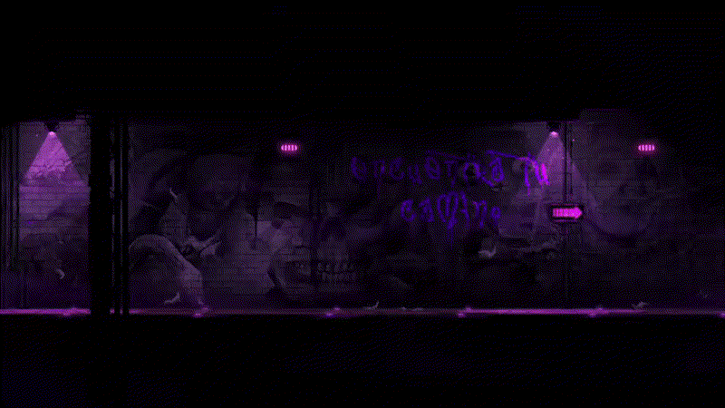

 

<!-- ANIMATED BANNER -->

 

# ✦ ASSIA BOUHALI

### EMBEDDED SYSTEMS & COMPUTER ENGINEERING

**Connecting Hardware · Software · Intelligence**

 

  

---

## ✧ WHO AM I?

I am an **Embedded Systems and Computer Engineering student** at Ibn Zohr University, Morocco.

My interests lie at the intersection of electronics, programming and intelligent technologies. I enjoy exploring how hardware and software can work together to build connected and intelligent systems.

I am continuously developing my technical skills through academic projects, practical experimentation and technology-focused training.

**My main interests:**

- Embedded Systems & Electronics
- Artificial Intelligence & Computer Vision
- Internet of Things (IoT)
- FPGA & Digital Systems
- Robotics and Intelligent Applications
- Linux & Cybersecurity

---

## ⚡ TECHNICAL UNIVERSE

### Programming & Development

### Embedded Systems & Electronics

### Artificial Intelligence & Data

### Tools & Environments

---

## 🚀 CURRENT PROJECTS

<table>
<tr>
<td width="50%" valign="top">

### ◈ Smart ADAS

**Advanced Driver Assistance System**

Exploring computer vision and AI techniques for intelligent road perception and driver assistance.

`Python` `OpenCV` `YOLO`

**Status:** In development

</td>
<td width="50%" valign="top">

### ◈ Precision Agriculture IoT

**Smart Greenhouse Monitoring**

Exploring sensor-based environmental monitoring and connected agricultural systems.

`Raspberry Pi` `Python` `IoT` `DHT11`

**Status:** In development

</td>
</tr>
</table>

*More projects and technical experiments will be added as they evolve.*

---

## 🎓 TRAINING & CERTIFICATIONS

- **Docker & DevOps Fundamentals** – Orange Digital Center, 2025
- **Kubernetes Fundamentals** – Orange Digital Center, 2025
- **SQL Property Graphs Master Class** – Oracle, 2025
- **AI & Data Science Program** – GCI World / University of Tokyo & JICA, 2026
- **Embedded AI with Raspberry Pi** – Orange Digital Center Agadir, 2026
- **MATLAB & Simulink** – Academic Training, 2026

---

## 🌍 LANGUAGES

| Language | Proficiency |
|:---|:---|
| Arabic | C1 |
| German | B2 |
| French | B1 |
| English | B1 |

---

## ✨ BEYOND THE CODE

I believe in continuous learning, hands-on experimentation and building technology that solves real-world problems.

**Explore. Build. Experiment. Improve.**

 

### LET'S CONNECT

Interested in embedded systems, IoT, AI or collaborative engineering projects?

 

© 2026 Assia Bouhali · Designed with curiosity and code.

